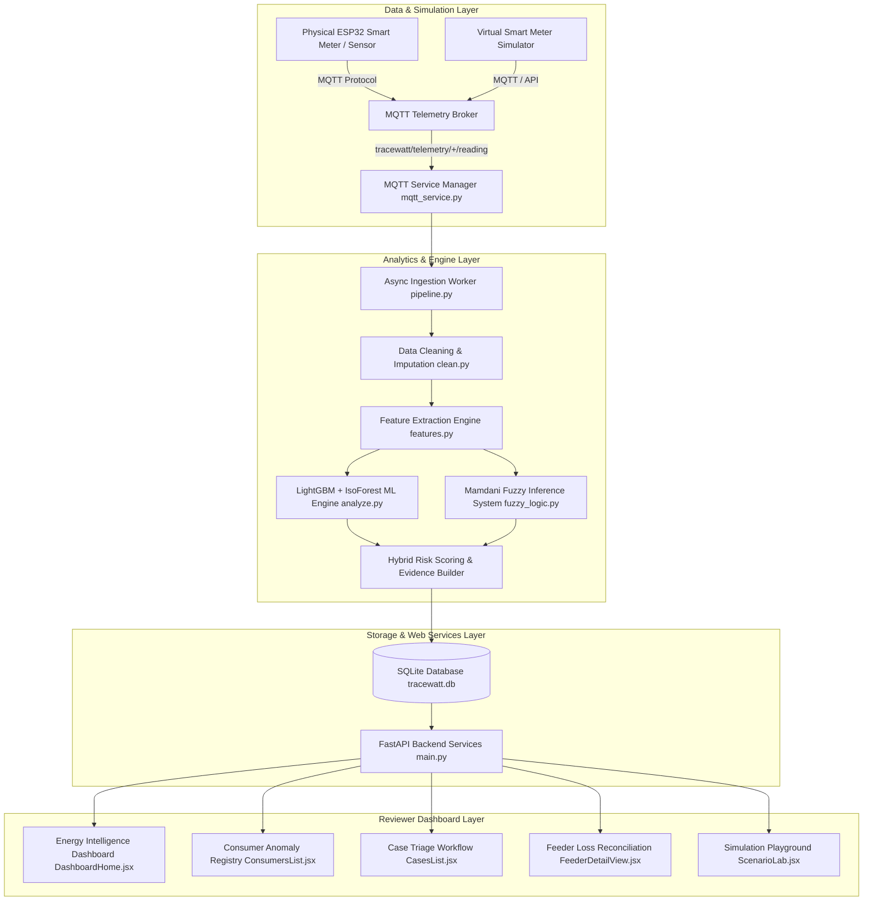

# ⚡ TraceWatt — Intelligent Electricity Theft & Non-Technical Loss (NTL) Analytics Platform

[](https://www.python.org/)
[](https://fastapi.tiangolo.com/)
[](https://reactjs.org/)
[](https://mqtt.org/)
[](LICENSE)

---

## 📌 Problem Statement Overview & Domain

**Domain**: Electrical Power Systems, Smart Grids, IoT, Machine Learning, Anomaly Detection, Time-Series Analysis, Energy Analytics, and Generative AI.

Electricity distribution utilities face immense revenue leakages due to **Non-Technical Losses (NTL)**—primarily caused by **electricity theft/tampering**, **faulty/tampered smart meters**, **communication gateway dropouts**, and **unaccounted distribution line gaps**. Traditional threshold-based alerting generates high false alarm rates because legitimate seasonal shifts, HVAC usage, or temporary business closures mirror theft patterns.

**TraceWatt** is a software-centric, end-to-end intelligent platform that continuously ingests smart meter telemetry, profiles consumer historical consumption baselines, reconciles feeder/transformer energy balances, and applies a **Hybrid ML + Mamdani Fuzzy Inference Engine** to deliver explainable anomaly scores, root-cause classifications, and prioritized field audit workflows.

---

## 🚀 Key Features & The 8 Core Deliverables

| # | Deliverable Name | Description & TraceWatt Capabilities | Architecture / Code Location |
|---|---|---|---|
| **1** | **Advanced Anomaly Detection Engine** | • Computes 8 temporal, statistical & behavioural features over rolling 30-day windows.<br>• Hybrid scoring combining **LightGBM**, **Isolation Forest**, and **30-day Moving Baseline**.<br>• Robust data cleaning & imputation handling missing/zero readings. | [`backend/engine/analyze.py`](file:///c:/Users/DELL/TraceWatt/backend/engine/analyze.py)<br>[`backend/datapipe/features.py`](file:///c:/Users/DELL/TraceWatt/backend/datapipe/features.py) |
| **2** | **Theft Risk & Fuzzy Cause Classification** | • Incorporates a **Mamdani-style Fuzzy Inference System (FIS)** evaluating linguistic variables (`drop_ratio`, `comm_error`, `meter_fault`, `peer_deviation`).<br>• Classifies 5 core domain scenarios with confidence scores and evidence ranking. | [`backend/engine/fuzzy_logic.py`](file:///c:/Users/DELL/TraceWatt/backend/engine/fuzzy_logic.py)<br>[`backend/app/services/engine_adapter.py`](file:///c:/Users/DELL/TraceWatt/backend/app/services/engine_adapter.py) |
| **3** | **Explainable Investigation Report** | • SHAP feature contribution ranking detailing **why** a consumer was flagged.<br>• Generates structured evidence, counter-evidence checks, and recommended field actions.<br>• PDF report generation endpoint (`/export/cases/{id}/pdf`). | [`backend/app/services/report_pdf.py`](file:///c:/Users/DELL/TraceWatt/backend/app/services/report_pdf.py)<br>[`ExplainabilityPanel.jsx`](file:///c:/Users/DELL/TraceWatt/dashboard/src/components/ExplainabilityPanel.jsx) |
| **4** | **Reviewer Web Dashboard** | • React + Tailwind web UI with multi-criteria filtering (*Risk*, *Feeder*, *Transformer*, *Category*).<br>• Interactive actual vs. baseline consumption charts (`Recharts`).<br>• Audit triage workflow (`New` $\rightarrow$ `Under Review` $\rightarrow$ `Inspection Scheduled` $\rightarrow$ `Confirmed` / `False Alarm` $\rightarrow$ `Closed`). | [`DashboardHome.jsx`](file:///c:/Users/DELL/TraceWatt/dashboard/src/pages/DashboardHome.jsx)<br>[`ConsumersList.jsx`](file:///c:/Users/DELL/TraceWatt/dashboard/src/pages/ConsumersList.jsx)<br>[`CasesList.jsx`](file:///c:/Users/DELL/TraceWatt/dashboard/src/pages/CasesList.jsx) |
| **5** | **Transformer & Feeder Analysis** | • Energy reconciliation between distribution intake meters and sum of consumer smart meters.<br>• Computes 5-day monitoring window loss percentages and flags suspicious consumer clusters. | [`backend/app/services/feeder_analysis.py`](file:///c:/Users/DELL/TraceWatt/backend/app/services/feeder_analysis.py)<br>[`FeederDetailView.jsx`](file:///c:/Users/DELL/TraceWatt/dashboard/src/pages/FeederDetailView.jsx) |
| **6** | **Continuous Virtual IoT & MQTT Layer** | • Real-time MQTT protocol subscriber (`tracewatt/telemetry/+/reading`) and publisher (`tracewatt/alerts/{id}`).<br>• Virtual Smart Meter Simulator streaming `voltage`, `current`, `power_kw`, `kwh`, `meter_status`, and `comm_status`. | [`backend/app/services/mqtt_service.py`](file:///c:/Users/DELL/TraceWatt/backend/app/services/mqtt_service.py)<br>[`backend/app/services/pipeline.py`](file:///c:/Users/DELL/TraceWatt/backend/app/services/pipeline.py) |
| **7** | **Scenario Test Suite & Simulation Lab** | • Interactive Simulation Playground (`ScenarioLab.jsx`) to inject synthetic events (*Theft*, *Meter Fault*, *Comms Failure*, *Seasonal Shift*, *Normal*). | [`ScenarioLab.jsx`](file:///c:/Users/DELL/TraceWatt/dashboard/src/pages/ScenarioLab.jsx)<br>[`backend/scripts/bootstrap_synthetic.py`](file:///c:/Users/DELL/TraceWatt/backend/scripts/bootstrap_synthetic.py) |
| **8** | **Reproducible Demo & End-to-End Pipeline** | • SQLite database (`tracewatt.db`) seeded with 300 consumers, 18,300 time-series readings, 300 triage cases, 148 alerts.<br>• Fully verified FastAPI REST endpoints returning 200 OK. | [`backend/app/main.py`](file:///c:/Users/DELL/TraceWatt/backend/app/main.py)<br>[`backend/app/seed.py`](file:///c:/Users/DELL/TraceWatt/backend/app/seed.py) |

---

## 🎯 Demonstration of 5 Domain Scenarios

1. **Electricity Theft / Tampering**:
   - *Pattern*: Consumption drops by 40–70% while meter status is `OK` and communication is active.
   - *TraceWatt Output*: Classified as **High Risk - Theft/Tampering** (Score $>0.80$). Generates evidence: *"Abrupt drop in active power without load reduction. Feeder aggregate balance shows corresponding gap."*
2. **Meter Malfunction**:
   - *Pattern*: Zero readings or stuck registers with `meter_status: FAULT` or active line voltage with zero current.
   - *TraceWatt Output*: Classified as **Medium Risk - Meter Malfunction**. Action: *"Schedule meter diagnostic team for recalibration."*
3. **Communication Failure**:
   - *Pattern*: Missing reading sequences and `comm_status: FAILED`.
   - *TraceWatt Output*: Avoids false theft alert. Classified as **Medium Risk - Communication Failure**. Action: *"Reset cellular modem interface."*
4. **Legitimate Abnormal Consumption**:
   - *Pattern*: Usage drop or spike correlated across peer consumers on the same feeder segment.
   - *TraceWatt Output*: Classified as **Low Risk - Legitimate Load Change / Seasonal Shift**.
5. **Normal Consumption**:
   - *Pattern*: Standard consumption inline with 30-day baseline.
   - *TraceWatt Output*: Classified as **Low Risk - Normal Pattern** (Score $<0.25$).

---

## 🏗️ System Architecture



---

## 💻 Tech Stack

- **Backend API**: Python 3.10+, FastAPI, Uvicorn, Pydantic, SQLAlchemy
- **Machine Learning & Analytics**: LightGBM, Scikit-Learn (IsolationForest), Pandas, NumPy, PyArrow
- **Fuzzy Logic**: Mamdani Fuzzy Inference Engine (Triangular, Trapezoidal, Gaussian MFs)
- **IoT & Protocols**: MQTT (`paho-mqtt`), Asyncio Queue Worker
- **Database**: SQLite (`tracewatt.db`)
- **Frontend Dashboard**: React 19, Tailwind CSS, Vite, Recharts, Axios, React Router v7

---

## 📡 REST API Reference

| Endpoint | Method | Description |
|---|---|---|
| `/health` | `GET` | System health check, DB, Fuzzy Engine, and MQTT status |
| `/dashboard/summary` | `GET` | Aggregated dashboard KPI metrics (consumers, alerts, cases, kWh) |
| `/dashboard/consumption-trend`| `GET` | 14-day aggregated actual vs. baseline consumption series |
| `/dashboard/risk-distribution` | `GET` | Consumer risk breakdown counts (High, Medium, Low) |
| `/consumers` | `GET` | List consumers with risk, feeder, category filters |
| `/consumers/{id}` | `GET` | Detailed consumer telemetry summary & baseline bounds |
| `/consumers/{id}/consumption` | `GET` | Actual daily consumption time series |
| `/consumers/{id}/baseline` | `GET` | Expected baseline curve time series |
| `/cases` | `GET` | List investigation triage cases |
| `/cases/{id}` | `GET` | Single investigation case details |
| `/cases/{id}/status` | `PATCH` | Update audit triage status (`New`, `Under Review`, `Confirmed`, etc.) |
| `/feeders` | `GET` | Distribution feeders list with unexplained loss percentages |
| `/feeders/{id}/losses` | `GET` | Transformer-level energy loss reconciliation series |
| `/alerts` | `GET` | Recent anomaly alert notifications |
| `/export/cases/{id}/pdf` | `GET` | Generate & download forensic investigation PDF report |

---

## ⚡ Quickstart & Installation Guide

### Prerequisites
- Python 3.10 or higher
- Node.js v18 or higher & npm

### 1. Clone & Setup Backend

```powershell
# Navigate to repository root
cd TraceWatt

# Install Python dependencies
pip install fastapi uvicorn sqlalchemy pandas numpy pyarrow joblib paho-mqtt pytest

# Seed SQLite database from synthetic data
python -m backend.app.seed

# Start FastAPI backend server
uvicorn backend.app.main:app --reload --port 8000
```
*API docs available at: `http://localhost:8000/docs`*

### 2. Setup & Run Frontend Dashboard

```powershell
# Open a new terminal and navigate to dashboard folder
cd TraceWatt/dashboard

# Install npm dependencies
npm install

# Start Vite development server
npm run dev
```
*Dashboard UI available at: `http://localhost:5173`*

### 3. Run Automated Tests

```powershell
# Run backend API test script
python C:\Users\DELL\.gemini\antigravity\brain\e3c303e3-c5c2-4672-991a-da3b1dbd79ce\scratch\test_api.py

# Verify Fuzzy Logic Inference Engine
python -c "from backend.engine.fuzzy_logic import fuzzy_engine; print(fuzzy_engine.evaluate(drop_ratio=0.85, comm_error=0.0, meter_fault=0.0, peer_deviation=0.9))"
```

---

## 📄 License & Citation

TraceWatt is released under the MIT License. Developed for Smart Grid Non-Technical Loss (NTL) Analytics and Electricity Theft Detection.
