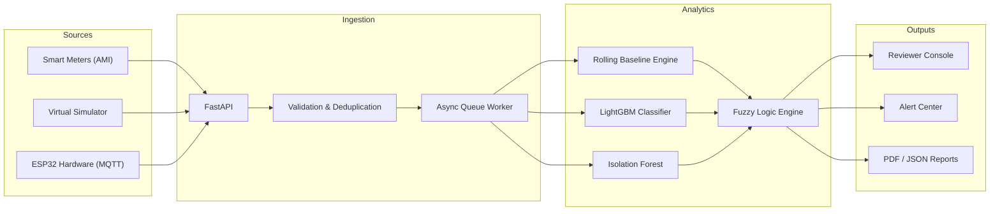

# TraceWatt

**Explainable non-technical loss (NTL) and anomaly detection for electricity distribution.**

TraceWatt ingests smart-meter telemetry, builds a per-consumer consumption baseline, detects anomalies with a hybrid ML pipeline, and attributes each flag to a likely root cause (theft or tampering, meter malfunction, communication failure, and so on). Every flag ships with the evidence behind it, the evidence against alternative explanations, and a recommended field action, so a human reviewer can accept or dismiss a case quickly.

**Stack:** Python · FastAPI · LightGBM · scikit-learn · SHAP · React · Vite · WebSockets · MQTT

---

## Table of Contents

- [Features](#features)
- [How It Works](#how-it-works)
- [Architecture](#architecture)
- [Evaluation](#evaluation)
- [Getting Started](#getting-started)
- [Virtual Meter Simulator](#virtual-meter-simulator)
- [API Reference](#api-reference)
- [Investigation Reports](#investigation-reports)
- [Testing](#testing)
- [Known Limitations](#known-limitations)
- [Roadmap](#roadmap)

---

## Features

**Detection and classification**
- Data cleaning: moving-median filtering for noise and `(consumer_id, ts)` unique keys for deduplication.
- Per-consumer 14-day rolling quantile baselines that adapt to daily and seasonal habits.
- Time-series feature extraction (drop length, month-over-month variance, peer deviation, and others).
- Hybrid model: calibrated LightGBM classifier + Isolation Forest anomaly score + Mamdani fuzzy-logic rules, blended 85/15 (ML/fuzzy).
- Continuous anomaly score (0.0 to 1.0) with a calibrated confidence value.
- Cases below 40% confidence are labelled **Requires Review** instead of being attributed to a cause.

**Explainability**
- SHAP-based top feature attributions for each flag.
- Counter-evidence checks: line voltage presence, meter and comms status flags, and transformer peer stability.
- Observed pattern labels such as *Abrupt Step Down*, *Zero Flatline*, and *Elevated Draw*.
- Cause-specific recommended field actions (for example, CT bypass audit or meter replacement).

**Reviewer console**
- Triage by risk level, feeder, transformer, and tariff category.
- Actual-vs-baseline interval charts with zoom.
- Case lifecycle: New → Under Review → Inspection Scheduled → Confirmed / False Alarm → Closed, with an audit trail and investigator notes.
- Live alert feed over WebSockets.
- PDF and JSON investigation reports.

**Grid analysis**
- Energy accounting rolled up from consumer to transformer to feeder.
- Loss hotspot view correlating feeder loss with consumer anomaly scores.
- Peer-band benchmarking against consumers on the same transformer.
- Cold-start handling: meters with fewer than 14 days of history fall back to feeder peer bands.

**Simulation and hardware**
- Virtual smart-meter simulator with injectable scenarios (shunts, partial bypass, dead sensor, packet loss, noise).
- MQTT ingestion path compatible with ESP32 + CT/PT sensor setups.

---

## How It Works

1. **Ingest.** Readings arrive via `POST /readings` or MQTT, are validated and deduplicated, then placed on an async worker queue.
2. **Profile.** The baseline engine resamples to a fixed 15-minute grid, fills short gaps (bounded forward-fill), and updates the rolling 14-day quantile envelope.
3. **Detect.** Features are extracted and scored by LightGBM and Isolation Forest. Fuzzy-logic rules interpret signals such as voltage presence, comm status, and peer behavior. The outputs are blended into a final score and cause.
4. **Explain.** SHAP attributions, observed pattern, and counter-evidence are attached to the case.
5. **Review.** The case appears in the console and alert feed. A reviewer works it through the status workflow and can export a report.

### Cause classes

| Class | Meaning |
|---|---|
| Theft / Tampering | Consumption drop consistent with bypass, shunting, or neutral tamper |
| Meter Malfunction | Hardware or sensor fault |
| Communication Failure | Data dropout without a consumption change |
| Legitimate Abnormal | Genuine but unusual load change |
| Seasonal Variation | Weather-driven demand shift |
| Normal | Within baseline envelope |
| Requires Review | Confidence below threshold; held for a human |

---

## Architecture



---

## Evaluation

All results below are measured on a **synthetic dataset of 840 consumers**, generated from two public Kaggle electricity consumption datasets, with injected scenarios providing the ground-truth labels. The full dataset was evaluated (no sampling). These numbers describe behavior on synthetic data and should not be read as expected performance on real utility data.

**Dataset composition**

| Class | Consumers | Share |
|---|---|---|
| Normal | 720 | 85.7% |
| Seasonal Variation | 40 | 4.8% |
| Theft / Tampering | 20 | 2.4% |
| Meter Malfunction | 20 | 2.4% |
| Communication Failure | 20 | 2.4% |
| Legitimate Abnormal | 20 | 2.4% |

**Overall**

| Metric | Value |
|---|---|
| Accuracy | 0.81 |
| Macro F1 | 0.42 |
| Mean inference latency | 59 ms |
| p95 inference latency | 123 ms |
| Throughput | ~17 consumers/s (single commodity machine) |

**Per-class**

| Class | Precision | Recall | F1 | Support |
|---|---|---|---|---|
| Normal | 0.92 | 0.43 | 0.59 | 720 |
| Meter Malfunction | 1.00 | 0.85 | 0.92 | 20 |
| Communication Failure | 1.00 | 0.85 | 0.92 | 20 |
| Theft / Tampering | 0.03 | 0.45 | 0.06 | 20 |
| Seasonal Variation | 0.11 | 0.03 | 0.04 | 40 |
| Legitimate Abnormal | 0.00 | 0.00 | 0.00 | 20 |

**Reading these results**

- Hardware faults (meter malfunction, communication failure) are detected reliably, with precision of 1.00 and recall of 0.85.
- Theft/tampering detection is currently weak. Precision of 0.03 and recall of 0.45 at a 2.4% prevalence are close to what random flagging would produce, and the theft ROC-AUC is 0.49. The explanation layer works on any flag, but the underlying theft classifier needs improvement (see [Roadmap](#roadmap)).
- Seasonal Variation and Legitimate Abnormal are essentially not separated from Normal yet.
- Low Normal recall (0.43) means many normal consumers are being flagged, which would cost reviewer time in a real deployment.

---

## Getting Started

### Prerequisites

- Python 3.11 or newer
- Node.js 18 or newer and npm

### Backend

```bash
cd backend
pip install -r requirements.txt
uvicorn app.main:app --reload --port 8000
```

The API is served at `http://localhost:8000`, with interactive docs at `http://localhost:8000/docs`.

### Dashboard

```bash
cd dashboard
npm install
npm run dev
```

Open `http://localhost:5173`.

---

## Virtual Meter Simulator

The simulator streams 15-minute readings (voltage, current, power, energy, meter and comm status) into the same ingestion path used by real devices. Scenarios can be injected per meter to exercise the detector:

- Physical shunt and partial bypass
- Dead sensor
- Packet loss
- Gaussian sensor noise

To use physical hardware, publish ESP32 CT/PT readings over MQTT using the same payload schema as `POST /readings`. No backend changes are needed.

---

## API Reference

| Method | Endpoint | Description |
|---|---|---|
| `GET` | `/health` | Queue status, database sync, pipeline latency |
| `GET` | `/dashboard/summary` | Loss KPIs, flagged consumer counts, estimated financial loss |
| `GET` | `/dashboard/evaluation` | Evaluation metrics and latency figures |
| `GET` | `/consumers` | Paginated consumers; filter by feeder, risk, category |
| `GET` | `/consumers/{id}/consumption` | Interval consumption time series |
| `GET` | `/consumers/{id}/baseline` | Rolling baseline curves |
| `GET` | `/cases` | Case queue with scores, causes, and priorities |
| `PATCH` | `/cases/{id}/status` | Update workflow status |
| `POST` | `/readings` | Ingest smart-meter telemetry |
| `GET` | `/export/cases/{id}/report` | JSON investigation report |
| `GET` | `/export/cases/{id}/pdf` | PDF investigation report |

---

## Investigation Reports

Each report (PDF and JSON) contains:

1. **Identity:** consumer ID, meter ID, tariff category, feeder, transformer.
2. **Baseline vs. actual:** baseline kWh/day, current kWh/day, net delta, percent deviation.
3. **Risk assessment:** anomaly score, attributed cause, confidence, priority, estimated financial loss (₹).
4. **Observed pattern:** pattern name and a plain-language summary.
5. **Why flagged:** top SHAP feature attributions.
6. **Counter-evidence:** checks that argue against an innocent explanation, such as outage, comm dropout, or weather.
7. **Recommended inspection:** field actions and inspector notes.

---

## Testing

```bash
# Backend (139 tests, ~73% coverage)
cd backend
pytest

# Dashboard contract tests
cd dashboard
npm test
```

Core API and pipeline modules have coverage above 80%. Offline utilities (`engine/train.py`, `engine/evaluate.py`, `app/seed.py`) and the MQTT/WebSocket services have lower coverage.

---

## Known Limitations

- **Synthetic data only.** The model has not been validated on real AMI data, and results may not transfer.
- **Theft classifier performance is low** on the current dataset (see [Evaluation](#evaluation)).
- **Class imbalance.** Rare classes are under-represented, and no resampling or loss re-weighting is applied yet.
- **Deprecation warnings.** About 49 warnings come from `datetime.utcnow()`, which should move to `datetime.now(timezone.utc)`.
- **Hardware path untested at scale.** MQTT/ESP32 ingestion works in lab conditions only.

---

## Roadmap

- Address class imbalance (SMOTE or focal loss) and retune the theft classifier and thresholds.
- Validate against real utility AMI data.
- Evaluate temporal models (LSTM / Transformer) for time-series anomaly detection.
- Add integration tests for `mqtt_service.py` and `ws.py`, targeting coverage above 85%.
- Replace `datetime.utcnow()` usage.

---

## Acknowledgments

Built for Code Utsava X.0 by the Turing Club of Programmers (TCP).
