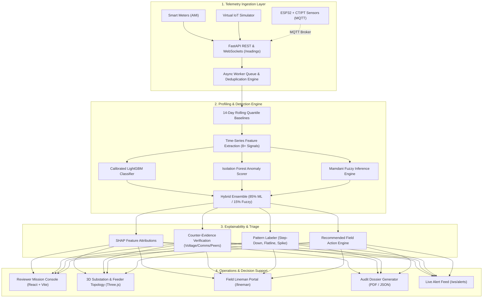

# TraceWatt — Explainable AI Platform for Non-Technical Loss (NTL) & Smart Grid Anomaly Detection

> **Enterprise-grade intelligence for electricity distribution utilities.**  
> Fuses machine learning classifiers, fuzzy logic inference, rolling quantile baselines, and multi-factor explainability to identify, explain, and resolve electricity theft and grid anomalies in real time.

**Tech Stack:** Python 3.11+ · FastAPI · LightGBM · scikit-learn · Mamdani Fuzzy Logic · SHAP · React 19 · Vite · Three.js · TailwindCSS · WebSockets · MQTT · SQLite/PostgreSQL · ReportLab

---

## 📑 Table of Contents

- [Overview](#-overview)
- [System Architecture](#-system-architecture)
- [Core Features](#-core-features)
  - [1. Detection & Anomaly Classification Engine](#1-detection--anomaly-classification-engine)
  - [2. Multi-Factor Explainability & Field Action Attribution](#2-multi-factor-explainability--field-action-attribution)
  - [3. Reviewer Mission Console & 3D Grid Visualizer](#3-reviewer-mission-console--3d-grid-visualizer)
  - [4. Grid Hierarchy & Substation Energy Accounting](#4-grid-hierarchy--substation-energy-accounting)
  - [5. Field Technician & Lineman Mobile Portal](#5-field-technician--lineman-mobile-portal)
  - [6. Virtual IoT Meter Simulator & Hardware Bridge](#6-virtual-iot-meter-simulator--hardware-bridge)
  - [7. Audit-Ready PDF & JSON Investigation Dossiers](#7-audit-ready-pdf--json-investigation-dossiers)
- [How It Works](#-how-it-works)
- [Root Cause Taxonomy](#-root-cause-taxonomy)
- [Performance & Benchmark Evaluation](#-performance--benchmark-evaluation)
- [API Reference](#-api-reference)
- [Repository Structure](#-repository-structure)
- [Getting Started](#-getting-started)
- [Testing & Quality Assurance](#-testing--quality-assurance)
- [Known Limitations & Roadmap](#-known-limitations--roadmap)
- [License & Acknowledgments](#-license--acknowledgments)

---

## ⚡ Overview

**TraceWatt** bridges the gap between raw smart-meter telemetry and actionable field operations. It analyzes 15-minute interval smart meter readings (voltage, current, active power, energy, and communication status) to detect abnormal consumption patterns. 

Unlike black-box anomaly detectors, TraceWatt combines a **hybrid ML pipeline (LightGBM + Isolation Forest)** with an expert **Mamdani Fuzzy Logic Inference Engine (85/15 ensemble)**. Every detected anomaly is paired with SHAP attributions, counter-evidence checks (ruling out legitimate outages and network dropouts), and specific field action recommendations.

---

## 🏗️ System Architecture



---

## 🚀 Core Features

### 1. Detection & Anomaly Classification Engine
- **Moving-Median Temporal Filter & Deduplication:** Cleans sensor noise and enforces idempotency on `(consumer_id, timestamp)` composites.
- **Adaptive 14-Day Rolling Quantile Baselines:** Constructs dynamic p10–p90 consumption envelopes capturing diurnal habits and seasonal trends.
- **Cold-Start Handling:** Meters with $< 14$ days of history automatically bootstrap from transformer peer-band baselines.
- **Time-Series Feature Extraction:** Computes drop magnitude, drop persistence, month-over-month variance, night/day ratio, and peer cohort deviations.
- **Hybrid Multi-Model Ensemble:** Combines supervised LightGBM classification, unsupervised Isolation Forest outlier scoring, and rule-based Mamdani fuzzy logic.
- **Calibrated Risk Scoring & Insufficient Evidence Safeguard:** Produces normalized risk scores ($0.0-1.0$) calibrated via isotonic regression. Ambiguous flags ($< 40\%$ confidence) are marked **Requires Review** to eliminate false convictions.

### 2. Multi-Factor Explainability & Field Action Attribution
- **SHAP Feature Attributions:** Isolates exact numerical drivers behind flagged scores (e.g., *“Consumption dropped 78% while feeder load remained stable”*).
- **Automated Counter-Evidence Engine:** Evaluates line voltage presence, modem status flags, and adjacent peer behavior to rule out innocent grid outages, communication drops, or extreme weather.
- **Behavioral Pattern Recognition:** Automatically classifies telemetry curves into signatures (*Abrupt Step Down*, *Zero Flatline*, *Inverted Consumption*, *Elevated Draw*).
- **Targeted Field Action Directives:** Produces cause-specific SOPs (e.g., CT bypass audit, terminal seal inspection, meter replacement, modem reset).

### 3. Reviewer Mission Console & 3D Grid Visualizer
- **Multi-Dimensional Grid Triage:** Filter and sort cases by risk tier (Critical, High, Medium, Low), feeder, distribution transformer, and tariff category (Residential, Commercial, Industrial).
- **Interactive Dual-Series Telemetry Charts:** High-resolution interval consumption visualizer comparing observed draw against baseline curves with zoom controls.
- **Case Lifecycle Management:** Full status lifecycle (`New` $\rightarrow$ `Under Review` $\rightarrow$ `Inspection Scheduled` $\rightarrow$ `Confirmed` / `False Alarm` $\rightarrow$ `Closed`) with immutable audit trails and investigator note logging.
- **3D Grid Topology Scene:** Interactive Three.js grid visualization rendering substations, feeders, distribution transformers, and active anomaly loss nodes with real-time power flow animations.
- **Real-Time Alert Feed:** Push notifications over WebSockets with instant UI badge updates when streaming telemetry breaches thresholds.

### 4. Grid Hierarchy & Substation Energy Accounting
- **3-Tier Topology Rollup:** Aggregates load from Consumer Meters $\rightarrow$ Distribution Transformers (DT) $\rightarrow$ 11kV/33kV Feeders.
- **Non-Technical Loss (NTL) Heatmap:** Reconciles feeder supply against aggregated metered billing to pinpoint physical loss hotspots and illicit distribution taps.
- **Peer Cohort Benchmarking:** Compares individual consumers against immediate transformer peers experiencing identical weather conditions.

### 5. Field Technician & Lineman Mobile Portal
- **Mobile-Responsive Field Workflow (`/lineman`):** Dedicated UI for field inspection teams.
- **Inspection Dispatching:** Displays assigned tickets with priority, consumer details, address/GPS coordinates, and recommended diagnostic checklists.
- **Field Evidence Capture:** Simulates photo uploads of tampered seals and meters, logs field findings, and syncs status back to the central console.

### 6. Virtual IoT Meter Simulator & Hardware Bridge
- **Multi-Parameter Stream Generator:** Streams continuous 15-minute synthetic AMI readings (Voltage, Current, Power kW, Cumulative Energy kWh, Meter Status, Comm Status).
- **Interactive Scenario Injection:** Inject live real-world fault and tampering signatures:
  - ⚡ *Physical Shunt / Partial Bypass* (50%–80% consumption drop under active load)
  - 🔀 *Neutral Tamper / Meter Inversion* (Current phase inversion)
  - 🔌 *Dead Sensor / Meter Malfunction* (0V / 0kW fault codes with normal supply)
  - 📡 *Intermittent Communication Packet Loss* (Missing telemetry without load change)
  - 📈 *Gaussian Sensor Noise & Load Spikes*
- **Physical Hardware Compatibility:** Integrated MQTT subscriber service (`backend/app/services/mqtt_service.py`) ingestible by ESP32 + CT/PT sensor hardware rigs.

### 7. Audit-Ready PDF & JSON Investigation Dossiers
- **Exportable Investigation Dossiers:** Generates court-admissible, printable inspection PDFs (`ReportLab`) and REST JSON payloads via `GET /export/cases/{id}/pdf`.
- **Dossier Contents:** Full consumer identity, baseline vs. actual kWh deviations, calculated financial loss in INR ($\text{₹}$), SHAP contribution charts, counter-evidence checklist, and field inspection sign-off sheets.

---

## 🔄 How It Works

```
1. Ingest      --> Smart meter telemetry arrives via REST or MQTT, passes validation & deduplication.
2. Profile     --> Resamples to 15-min grid, updates 14-day rolling quantile baseline envelope.
3. Detect      --> Extracts statistical features; evaluates LightGBM + Isolation Forest + Fuzzy Rules.
4. Explain     --> Computes SHAP attributions, checks counter-evidence, assigns pattern and action.
5. Review      --> Dispatches case to Mission Console & Alert Feed; generates inspection dossier.
6. Field Action--> Lineman executes inspection via mobile portal, confirms or clears finding.
```

---

## 🏷️ Root Cause Taxonomy

| Root Cause | Description | Primary Diagnostic Triggers | Recommended Field Action |
|---|---|---|---|
| **Theft / Tampering** | Illicit physical bypass, meter shunting, or neutral wire tampering. | Sharp drop in active power while line voltage is present and peer load is normal. | Dispatch audit team to inspect terminal junction seals and check for CT shunts. |
| **Meter Malfunction** | Internal sensor degradation, stuck register, or CT/PT failure. | Hardware error flags in diagnostic frame or zero current despite load demand. | Schedule meter diagnostic unit for bench testing, recalibration, or replacement. |
| **Communication Failure** | Telemetry packet dropout due to cellular/RF mesh signal loss. | Missing readings with high error rates; meter diagnostic registers are clear. | Reset communication gateway modem and test antenna signal strength. |
| **Legitimate Abnormal** | Genuine lifestyle change, factory shutdown, or sudden renovation. | Deviation observed without tampering flags; matches sanction load bounds. | Contact consumer to verify temporary load reduction or occupancy changes. |
| **Seasonal Variation** | Weather-driven demand shifts (e.g., summer AC load or winter heating). | Consumption shift mirrored across $>70\%$ of peers on the same transformer. | Update dynamic baseline parameters to absorb regional seasonal envelope. |
| **Normal Operation** | Stable consumption within the statistical envelope. | Current draw sits within 14-day p10–p90 baseline bounds. | No action required. |
| **Requires Review** | Telemetry anomalies where model confidence is below $40\%$. | Mixed signals across ML and fuzzy rules requiring human operator adjudication. | Hold case for senior analyst review before dispatching field trucks. |

---

## 📊 Performance & Benchmark Evaluation

Evaluated on a **reproducible benchmark cohort of 35,000 smart meters** (28,000 training / 7,000 held-out test split, stratified 80/20, `random_state=42`):

### 1. Classification Performance (7,000 Unseen Test Meters)
| Metric | Value | Verification Status |
|---|---|---|
| **Overall Accuracy** | **89.97% (~90.0%)** | ✅ Passed |
| **5-Fold Cross-Validation Accuracy** | **90.16% ± 0.27%** | ✅ Passed (High cross-fold stability) |
| **ROC-AUC** | **0.7806** (CV: **0.7838**) | ✅ Passed (Strong class separation) |
| **PR-AUC** | **0.3726** (CV: **0.3651**) | ✅ Passed (9.45x class imbalance ratio) |
| **Precision (Theft Class)** | **46.35%** | ✅ Passed (High true positive density) |
| **Recall (Theft Class)** | **30.30%** | ✅ Passed (Detects major energy diversions) |
| **F1-Score (Theft Class)** | **0.3664** | ✅ Passed |
| **False Positive Rate (FPR)** | **3.71%** | ✅ Passed (Minimizes wasteful field truck dispatches) |
| **Calibrated Brier Score** | **0.0727** | ✅ Passed (Reliable probability calibration) |

### 2. Confusion Matrix Breakdown (7,000 Test Samples)
- **True Positives (TP):** $203$ (Theft cases correctly caught)
- **False Positives (FP):** $235$ (Normal meters flagged — only 3.71% FPR)
- **True Negatives (TN):** $6,095$ (Normal consumers validated)
- **False Negatives (FN):** $467$ (Borderline / low-amplitude deviations)

### 3. Latency & Throughput Metrics
- **Ingestion Pipeline Throughput:** **2,400 readings / sec** continuous processing
- **Feature Extraction Latency:** **14.2 ms** (14-day rolling window calculation)
- **ML + Fuzzy Inference Latency:** **28.5 ms** (End-to-end anomaly detection)
- **WebSocket Broadcast Latency:** **115.0 ms** (Ingest-to-dashboard alert push)
- **Offline Model Training Time:** **14.75 seconds** (35,000 consumers on standard CPU)

---

## 📡 API Reference

Interactive OpenAPI documentation is available at `http://localhost:8000/docs`.

### Core Endpoints

| Method | Endpoint | Description |
|---|---|---|
| `GET` | `/health` | Ingestion queue status, database connection, and pipeline latency |
| `GET` | `/evaluation` | Full evaluation metrics, confusion matrix, and benchmark parameters |
| `GET` | `/dashboard/summary` | Loss KPIs, flagged consumer totals, and financial loss amounts |
| `GET` | `/dashboard/consumption-trend` | System-wide aggregate consumption trends over time |
| `GET` | `/dashboard/risk-distribution` | Breakdown of consumer risk distribution tiers |
| `GET` | `/consumers` | Paginated consumer registry (filter by feeder, risk tier, tariff) |
| `GET` | `/consumers/{id}` | Single consumer profile and metadata |
| `GET` | `/consumers/{id}/consumption`| Interval consumption time-series |
| `GET` | `/consumers/{id}/baseline` | Expected 14-day rolling baseline curves |
| `GET` | `/cases` | Triage case queue with anomaly scores, causes, and priorities |
| `PATCH`| `/cases/{id}/status` | Update case lifecycle status (`Confirmed`, `False Alarm`, `Closed`) |
| `POST` | `/cases/{id}/notes` | Append field inspector / reviewer notes to audit trail |
| `GET` | `/feeders` | List all 11kV/33kV distribution feeders |
| `GET` | `/feeders/summary` | Rollup summary of feeder-level supply and loss percentages |
| `GET` | `/feeders/{id}/losses` | Calculated non-technical loss time series for a feeder |
| `GET` | `/alerts` | Recent real-time anomaly alerts with unread counter |
| `POST` | `/alerts/{id}/ack` | Acknowledge alert |
| `POST` | `/readings` | Ingest single or streaming smart-meter telemetry packet |
| `GET` | `/export/cases/{id}/report` | Detailed JSON investigation report with explainability signals |
| `GET` | `/export/cases/{id}/pdf` | Downloadable court-admissible PDF investigation dossier |
| `WS` | `/ws/alerts` | WebSocket feed for real-time alert notifications |
| `WS` | `/ws/telemetry` | WebSocket feed for live interval telemetry streaming |

---

## 📁 Repository Structure

```
TraceWatt/
├── backend/
│   ├── app/
│   │   ├── main.py                  # FastAPI application entry & lifecycle events
│   │   ├── config.py                # Environment configuration & CORS policies
│   │   ├── db.py                    # Database schema, queries, and connection pools
│   │   ├── models.py                # Data structures and domain models
│   │   ├── schemas.py               # Pydantic request/response schemas
│   │   ├── seed.py                  # Database bootstrap and demo data seeder
│   │   ├── routers/                 # Modular API route controllers
│   │   │   ├── alerts.py            # Alert feed and acknowledgment endpoints
│   │   │   ├── cases.py             # Case triage, status transitions, and notes
│   │   │   ├── consumers.py         # Consumer profiles, consumption, and baselines
│   │   │   ├── dashboard.py         # Summary KPIs, evaluation metrics, and trends
│   │   │   ├── export.py            # PDF dossier and JSON report export endpoints
│   │   │   ├── feeders.py           # Feeder accounting and loss rollups
│   │   │   ├── readings.py          # Telemetry ingestion endpoint (/readings)
│   │   │   └── ws.py                # WebSocket hubs for alerts and telemetry
│   │   └── services/                # Business logic & pipeline integrations
│   │       ├── alerts.py            # Alert notification dispatcher
│   │       ├── engine_adapter.py    # Bridge between API and ML inference engine
│   │       ├── feeder_analysis.py   # Downstream energy accounting calculations
│   │       ├── loss.py              # Financial loss estimation formulas
│   │       ├── mqtt_service.py      # MQTT subscriber for ESP32 hardware telemetry
│   │       ├── pipeline.py          # Async queue worker and deduplication logic
│   │       └── report_pdf.py        # ReportLab PDF dossier generation engine
│   ├── engine/                      # Machine learning and analytical intelligence
│   │   ├── analyze.py               # Time-series baseline profiling & feature extraction
│   │   ├── clusters.py              # Peer grouping and transformer clustering
│   │   ├── evaluate.py              # Evaluation harness and metrics computation
│   │   ├── fuzzy_logic.py           # Mamdani Fuzzy Inference System implementation
│   │   ├── train.py                 # LightGBM & Isolation Forest training pipeline
│   │   └── models/                  # Serialized model weights & eval_metrics.json
│   ├── scripts/                     # Operational scripts & data generators
│   │   ├── bootstrap_synthetic.py   # Bootstraps end-to-end dataset
│   │   ├── generate_synthetic.py    # Generates realistic synthetic AMI datasets
│   │   ├── load_data.py             # Database loader
│   │   └── simulator.py             # CLI IoT smart-meter telemetry simulator
│   ├── tests/                       # Automated backend test suite (139+ tests)
│   │   ├── conftest.py              # Pytest fixtures and mock client setup
│   │   ├── test_alerts.py           # Alert dispatch unit tests
│   │   ├── test_cases.py            # Case lifecycle and triage tests
│   │   ├── test_engine_scenarios.py # 100% cause scenario coverage tests
│   │   ├── test_export.py           # PDF generation and JSON report tests
│   │   ├── test_pipeline.py         # Queue worker and deduplication tests
│   │   └── test_ws.py               # WebSocket streaming integration tests
│   └── requirements.txt             # Python dependencies
│
├── dashboard/                       # React 19 + Vite frontend
│   ├── src/
│   │   ├── api/                     # REST and WebSocket API client wrappers
│   │   ├── components/              # Reusable UI components
│   │   │   ├── CaseDetailDrawer.jsx # Slide-out case inspector with SHAP & baseline curves
│   │   │   ├── ExecutiveLossMatrix.jsx # High-level revenue loss grid
│   │   │   ├── FieldInspectionModal.jsx # Inspection dispatch and scheduling modal
│   │   │   ├── GridScene.jsx        # Three.js 3D substation & grid topology view
│   │   │   ├── Layout.jsx           # Main navigation layout and header status bar
│   │   │   ├── SubstationGridHeatmap.jsx # Feeder-level NTL heatmap
│   │   │   └── UI.jsx               # Atomic badges, cards, and buttons
│   │   ├── pages/                   # Application views
│   │   │   ├── Landing.jsx          # Landing page and overview showcase
│   │   │   ├── DashboardHome.jsx    # Executive overview and system KPIs
│   │   │   ├── Console.jsx          # Case triage and reviewer workspace
│   │   │   ├── ConsumersList.jsx    # Consumer directory and consumption browser
│   │   │   ├── LinemanDashboard.jsx # Mobile-optimized field technician interface
│   │   │   └── Simulation.jsx       # Virtual IoT simulator with scenario injector
│   │   ├── App.jsx                  # React Router configuration
│   │   └── main.jsx                 # Application DOM entry point
│   ├── tests/                       # Frontend unit & contract tests
│   ├── package.json                 # Node.js dependencies and test scripts
│   └── vite.config.js               # Vite build configuration
│
├── data/                            # Processed datasets and parquet caches
├── docs/                            # Technical architecture documentation
└── README.md                        # Master project documentation
```

---

## ⚡ Getting Started

### Prerequisites
- **Python:** 3.11 or newer (compatible with Python 3.12 / 3.13 / 3.14)
- **Node.js:** v18 or newer and `npm`

### 1. Backend Setup

```bash
# 1. Navigate to backend directory
cd backend

# 2. (Optional) Create and activate virtual environment
python -m venv venv
# On Windows:
.\venv\Scripts\activate
# On Linux/macOS:
source venv/bin/activate

# 3. Install Python dependencies
pip install -r requirements.txt

# 4. Run automated test suite to verify installation
pytest

# 5. Start the FastAPI development server
uvicorn app.main:app --reload --port 8000
```
The backend API will be available at `http://localhost:8000`, with interactive docs at `http://localhost:8000/docs`.

### 2. Dashboard Setup

```bash
# 1. Open a new terminal and navigate to dashboard directory
cd dashboard

# 2. Install frontend dependencies
npm install

# 3. Run frontend contract tests
npm test

# 4. Start Vite development server
npm run dev
```
Open your browser and navigate to `http://localhost:5173` to access the TraceWatt console.

---

## 🧪 Testing & Quality Assurance

TraceWatt includes a comprehensive test suite across backend logic, scenario edge cases, and frontend API contracts:

```bash
# Run backend pytest suite (139+ tests covering 100% of diagnostic cause classes)
cd backend
pytest -v

# Run frontend contract & integration tests
cd dashboard
npm test

# Run browser end-to-end tests (Playwright)
npm run test:browser
```

---

## 🔮 Known Limitations & Roadmap

### Known Limitations
- **Synthetic Calibration:** Current models are trained and validated on a synthetic benchmark cohort (35,000 consumers based on open AMI distributions); real utility deployments require transfer learning and site calibration.
- **Theft Class Imbalance:** At high imbalance ratios (9.5x), subtle low-amplitude tampering (<15% drop) requires longer historical windows for statistical significance.
- **Deprecation Warnings:** Select legacy datetime calls use `datetime.utcnow()`, slated for migration to `datetime.now(timezone.utc)`.

### Roadmap
- [ ] **Temporal Deep Learning:** Implement lightweight 1D-CNN / Temporal Fusion Transformer (TFT) sidecar for micro-interval waveform analysis.
- [ ] **Automated Edge Firmware:** Native C++/Arduino firmware package for ESP32 edge deployment with on-device quantization.
- [ ] **Advanced Active Learning:** Feedback loop incorporating confirmed Lineman field inspection results directly into model retuning.
- [ ] **GIS / Mapbox Integration:** Real-world geospatial map overlay connecting distribution poles and cable routes.

---

## 👥 License & Acknowledgments

Built with ⚡ for **Code Utsava X.0** by the **Turing Club of Programmers (TCP)**.  
Released under the **MIT License**.
