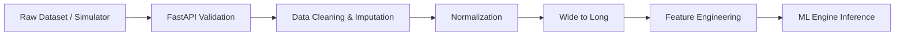

# TraceWatt — Technical Approach & System Architecture

## 1. System Overview

**TraceWatt** is an end-to-end Energy Intelligence and Anomaly Detection platform. Its primary purpose is to help electricity utilities monitor power grids, detect Non-Technical Losses (NTL) such as electricity theft, identify communication or hardware faults, and triage these issues for field inspection. 

The core philosophy of TraceWatt is **Actionable Explainability**. Rather than functioning purely as a black-box AI tool, TraceWatt combines supervised and unsupervised Machine Learning (LightGBM + Isolation Forest) with SHAP (SHapley Additive exPlanations) to translate complex anomaly scores into plain-English "Evidence" and "Counter-Evidence." This ensures that reviewers and field linemen know exactly *why* a consumer was flagged and *what* to investigate.

### The TraceWatt Implementation Flow

```text
Raw Electricity Data (Smart Meter Telemetry / Simulator)
        ↓
Data Validation & Schema Enforcement (FastAPI)
        ↓
Feature Engineering (Rolling metrics, time-series aggregations)
        ↓
Baseline Generation (Historical comparison)
        ↓
Anomaly Detection (Isolation Forest for structural anomalies)
        ↓
Cause Classification (LightGBM + Fuzzy Logic for Theft vs. Faults)
        ↓
Explainability (SHAP tree explainer generates human-readable evidence)
        ↓
Loss Estimation ((Expected - Actual) × Tariff)
        ↓
Investigation Priority (Anomaly Score × Confidence × Loss)
        ↓
Cases + Alerts Database (SQLite/SQLAlchemy)
        ↓
TraceWatt Mission Console & Lineman Dashboard (React/Vite)
```

*(Note: Worker/Queue mechanisms such as Celery/RabbitMQ are planned for future scale but currently implemented synchronously in the live API pipeline).*

---

## 2. Technical Approach

The technical approach is built on a modern, decoupled architecture splitting the Machine Learning pipeline, the RESTful Backend, and the Single Page Application (SPA) Frontend.

### 2.1 Data Sources

TraceWatt utilizes the following implemented data sources:

- **Historical Electricity Consumption Datasets:** Synthetic/Kaggle-derived datasets processed via the internal `datapipe` containing historical `kwh`, voltage, and current.
- **Consumer Metadata:** Categorical information (Residential, Commercial, Industrial), tariffs, and geographical hierarchy (Feeder ID, Transformer ID).
- **Virtual Smart-Meter Simulator:** A python-based simulator (`run_simulator.py`) that generates real-time telemetry, including simulated noise, theft scenarios, and communication drops, pushed directly to the backend via HTTP.
- **Meter Status & Communication Status:** Boolean/categorical flags representing hardware integrity and network uptime.

*(Note: Weather and seasonal meteorological data are conceptually specified in problem statements but are not currently implemented as active ML features in the TraceWatt codebase).*

---

## 3. Data Preprocessing

Data preprocessing occurs in two phases: Historical batch processing (for model training) and Live processing (for telemetry ingestion).

1. **Validation & Cleaning:** The `/readings` endpoint and `datapipe/clean.py` enforce schemas, dropping unprocessable records and imputing missing telemetry using forward-fill techniques.
2. **Wide to Long Transformation:** Dataset structures are normalized into a standardized event-driven format.
3. **Feature Engineering:** The `datapipe/features.py` script and the live pipeline compute critical temporal features such as:
   - `volatility_7d`: 7-day consumption variance.
   - `kwh_diff`: Sudden drops in energy compared to moving averages.
   - Fault flags: Aggregated hardware and communication error counts.



---

## 4. Machine Learning & Anomaly Detection

TraceWatt utilizes a **Hybrid AI Engine** combining both supervised classification and unsupervised anomaly detection.

- **Isolation Forest:** Used for unsupervised detection of structural anomalies. It is particularly effective at catching novel bypass methods that the supervised model has not been explicitly trained on.
- **LightGBM:** A gradient boosting framework trained on labeled historical data to classify the root cause of an anomaly. The model is calibrated using Isotonic Regression to output reliable probability distributions.
- **SHAP Integration:** The `engine_adapter.py` runs a `shap.TreeExplainer` on the model outputs. Feature contributions are mapped to text templates (e.g., *"Consumption dropped significantly from its normal pattern"*) resulting in the `evidence` and `counter_evidence` arrays sent to the UI.

---

## 5. Case Management & Loss Estimation

Once an anomaly is flagged by the ML Engine, it enters the **Case Management Pipeline**.

### Loss Estimation
Calculated purely in `loss.py` via the formula:
`estimated_loss = max(baseline_kwh - actual_kwh, 0.0) * tariff`
*(Where the tariff dynamically adjusts based on the consumer's category, defaulting to 0.15 if unspecified).*

### Priority Ranking
Field dispatch priority is determined by multiplying three factors:
`priority_score = anomaly_score × confidence × estimated_loss`
This ensures that highly confident, large-scale financial thefts appear at the top of the investigation queue.

### Case Lifecycle
TraceWatt implements a robust state machine via SQLAlchemy:
`New` → `Under Review` → `Inspection Scheduled` → `Confirmed` / `False Alarm` / `Closed`

---

## 6. Frontend Architecture

The frontend is a **React (Vite)** Single Page Application, utilizing **React Router** for navigation and **Recharts** for analytics visualization. It consists of two primary operational spaces:

1. **Mission Console (Admin/Analyst View):**
   - **Feeder Analytics:** Rollup metrics showing unexplained losses calculated hierarchically at the Transformer and Feeder levels (`(Input - Metered) / Input`).
   - **Scenario Simulator:** UI-driven controls to inject theft, noise, or communication failures into specific consumers in real-time.
   - **Consumer Investigation:** Deep-dive dashboards showing actual vs. baseline consumption graphs alongside SHAP-derived explanations.

2. **Lineman Dashboard (Field Operations View):**
   - Designed strictly as an **Action Dashboard**.
   - Hides technical ML complexities (SHAP, Isolation Forest).
   - Shows a mobile-friendly prioritized work queue.
   - Provides "Location / Network Context" and clear "Recommended Checks".
   - Enables linemen to add resolution notes and close cases directly from the field.

---

## 7. Database & Deployment

### Database
TraceWatt uses an Object-Relational Mapper (**SQLAlchemy**) to manage data persistence. It is currently configured to use **SQLite** (`tracewatt.db`) for rapid deployment and local simulation, but the ORM architecture allows seamless migration to **PostgreSQL** for production scale. 

### Deployment Infrastructure
The application is fully prepared for modern cloud hosting:
- **Backend (FastAPI):** Configured for deployment on **Render** (via `render.yaml`) or Heroku. Uses `uvicorn` as the ASGI server. CORS is configured to allow wildcard origins `["*"]` to ensure seamless API connectivity.
- **Frontend (React/Vite):** Configured for Edge deployment on **Vercel** or Netlify. A `vercel.json` file handles SPA routing rewrites ensuring deep links function correctly.
- **Environment Management:** API connectivity is mapped via standard `.env` configuration (`VITE_API_URL`), bridging the split architecture in production environments.
